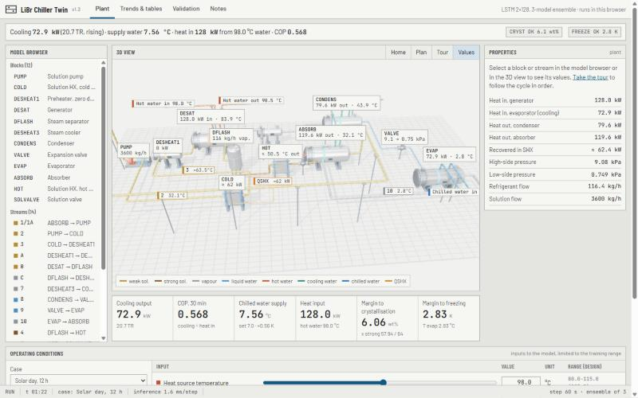
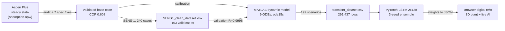

# AI for Transient Behaviour Prediction in Absorption Chillers

A complete, reproducible pipeline that turns an **Aspen Plus** steady-state model of a single-effect H₂O–LiBr absorption chiller into a **dynamic MATLAB model**, generates a **transient dataset**, trains an **LSTM neural network** that predicts the chiller minute by minute, and deploys it as a **browser-based digital twin** with a 3D plant view.

7th-semester project, Department of Chemical Engineering, IIT Jodhpur, 2026.

**Live demo: [libr-chiller-twin.vercel.app](https://libr-chiller-twin.vercel.app)** — the digital twin, hosted on Vercel. The AI model runs in your browser.



---

## Contents

1. [Headline results](#headline-results)
2. [Pipeline at a glance](#pipeline-at-a-glance)
3. [Repository structure](#repository-structure)
4. [Quick start](#quick-start)
5. [Documentation index](#documentation-index)
6. [Software and data versions](#software-and-data-versions)
7. [Large files (Git LFS)](#large-files-git-lfs)
8. [Limitations](#limitations)
9. [References](#references)

---

## Headline results

| Stage | Result |
|---|---|
| Aspen Plus steady state | The energy balance was corrected from a residual of 42,438 kcal/h (COP 0.21) to a residual of **0.046 %** (COP **0.611**). After the pressure-master setup, the base case gives COP **0.608**. No blocks were added or removed, and the property method (ELECNRTL) and components are unchanged. |
| Sensitivity dataset (SENS-1) | 241 converged cases. **163** are physically valid after crystallisation and phase checks. The energy residual is at most 0.24 %, and the dataset passes 15 independent verification checks. |
| MATLAB dynamic model | Steady state equals the Aspen base case (all states within 0.001). COP correlates with the 163 SENS-1 cases at **R = 0.9998**. Energy conservation error is at most **0.032 %** per run. |
| Transient dataset | 199 simulated runs, **197 valid**, giving **291,437 rows** at 10 s with 40 columns. The runs are split by run into 134 train, 29 validation and 34 test. |
| AI model (LSTM ×3 ensemble) | On 34 unseen test runs: mean R² **0.99914**, mean NRMSE **0.38 %**. Q_evap RMSE is 0.31 kW and T_chw,out RMSE is 0.024 K. On the 12 h daily profiles, R² is 0.99993. |
| Baselines | Gradient boosting on current inputs only: R² 0.745. Gradient boosting with lagged inputs: R² 0.978. |
| Digital twin (web) | The LSTM runs in JavaScript and matches PyTorch to within **0.0014 kW**. Each step takes about 1.5 ms. The page has a 3D plant laid out like the Aspen flowsheet, live stream values, scenarios and a validation replay. |

---

## Pipeline at a glance



| # | Stage | Folder | Main tool | Output |
|---|---|---|---|---|
| 1 | Steady-state model, energy-balance audit, sensitivity dataset | [`Steady_state/`](Steady_state/) | Aspen Plus (ELECNRTL) | `SENS1_clean_dataset.xlsx` |
| 2 | Dynamic model and transient dataset | [`Transient/`](Transient/) | MATLAB R2025a (no toolboxes) | `output/transient_dataset.csv` |
| 3 | Machine learning | [`ML_model/`](ML_model/) | Python 3.12, PyTorch, scikit-learn | `outputs/models/*` and metrics |
| 4 | Digital twin dashboard | [`Dashboard/`](Dashboard/) | HTML, JavaScript, three.js | `chiller_dashboard.html` |
| — | Documentation | [`docs/`](docs/) | Markdown | This documentation |

---

## Repository structure

```
Absorption_chiller/
├── README.md                     <- you are here
├── .gitignore / .gitattributes   <- ignore rules, line endings, Git LFS tracking
├── docs/                         <- full project documentation (start with docs/README.md)
│   ├── 01_project_overview.md
│   ├── 02_steady_state_aspen.md
│   ├── 03_transient_model_matlab.md
│   ├── 04_machine_learning.md
│   ├── 05_digital_twin_dashboard.md
│   ├── 06_results_summary.md
│   ├── 07_reproducibility_guide.md
│   ├── 08_project_log.md
│   ├── 09_file_reference.md
│   ├── 10_limitations_and_future_work.md
│   └── images/
├── Steady_state/                 <- Stage 1: Aspen Plus
│   ├── absorption.apw            <- Aspen Plus model
│   ├── Aspen_fix_parameters.md   <- audit, root causes, corrected specs, validation runs
│   ├── SENS-1_setup_guide.md     <- click-by-click guide for the sensitivity block
│   ├── SENS1_clean_dataset.xlsx  <- FINAL steady-state dataset (163 valid cases)
│   ├── Streams_result.xlsx       <- original stream results (before the fixes)
│   ├── Steady_state_dataset.xlsx <- original SENS-1 export (invalid, kept for the record)
│   ├── Prompt.txt                <- original project brief and constraints
│   └── Screenshot ... .png       <- Aspen flowsheet
├── Transient/                    <- Stage 2: MATLAB dynamic model
│   ├── run_all.m                 <- single entry point
│   ├── src/                      <- model, properties, calibration, scenarios, validation
│   ├── data/SENS1_ML_dataset.csv <- validated Aspen cases used for validation
│   └── output/                   <- dataset (LFS), run summary, dictionary, parameters, report, figures
├── ML_model/                     <- Stage 3: neural network
│   ├── run_ml.py                 <- train, evaluate, export (single entry point)
│   ├── export.py                 <- saves models, metrics, predictions, figures
│   ├── ml/                       <- data.py, models.py, baselines.py
│   ├── requirements.txt
│   └── outputs/                  <- models/, results/, figures/, training logs
└── Dashboard/                    <- Stage 4: digital twin web app
    ├── chiller_dashboard.html    <- double-click to open (the deliverable)
    ├── build_dashboard.py        <- packs model + data into the page
    ├── twin_engine.js            <- LSTM forward pass in JavaScript
    ├── ui_v3_shell.html, make_template_v3.py, dashboard_template*.html
    └── README.md
```

Every file is described in [docs/09_file_reference.md](docs/09_file_reference.md).

---

## Quick start

```bash
git clone https://github.com/darshanprajapati07/Absorption_chiller.git
cd Absorption_chiller
git lfs pull          # downloads the 174 MB transient dataset and the .mat file
```

**Just view the result:** open `Dashboard/chiller_dashboard.html` in Chrome or Edge. The AI and all the numbers work offline. The 3D view loads three.js from a CDN, so it needs internet the first time.

**Re-run each stage.** The full details are in [docs/07_reproducibility_guide.md](docs/07_reproducibility_guide.md).

| Stage | Command | Time |
|---|---|---|
| 1 Aspen | Open `Steady_state/absorption.apw`, then Run. Re-run SENS-1 as described in `SENS-1_setup_guide.md`. | minutes |
| 2 MATLAB | In `Transient/`: `run_all` (or `run_all('quick')`) | ≈ 5 min |
| 3 Python | In `ML_model/`: `pip install -r requirements.txt`, then `python run_ml.py` (or `--quick`) | ≈ 2.4 h CPU (≈ 5 min quick) |
| 4 Dashboard | In `Dashboard/`: `python build_dashboard.py` | seconds |

---

## Documentation index

| Document | What it covers |
|---|---|
| [docs/01_project_overview.md](docs/01_project_overview.md) | The problem, the objectives, the constraints, the chiller and its flowsheet (blocks and streams), and the overall approach |
| [docs/02_steady_state_aspen.md](docs/02_steady_state_aspen.md) | Aspen model, the 5 root causes of the energy-balance error, the corrected specifications, the validated base case, SENS-1 design, data cleaning and 15-point verification |
| [docs/03_transient_model_matlab.md](docs/03_transient_model_matlab.md) | Dynamic model equations, properties, calibration, water-circuit design, scenarios, validity filters, validation against Aspen, and dataset columns |
| [docs/04_machine_learning.md](docs/04_machine_learning.md) | Problem framing, preprocessing, the models, hyperparameters, training, results per output, and exported artefacts |
| [docs/05_digital_twin_dashboard.md](docs/05_digital_twin_dashboard.md) | Architecture, the JavaScript inference engine and its verification, the 3D plant, derived stream values, the UI design and its three versions |
| [docs/06_results_summary.md](docs/06_results_summary.md) | Every key number of the project in one place |
| [docs/07_reproducibility_guide.md](docs/07_reproducibility_guide.md) | Environment and step-by-step commands to reproduce everything |
| [docs/08_project_log.md](docs/08_project_log.md) | Chronological log of the work, the problems met and how each was solved |
| [docs/09_file_reference.md](docs/09_file_reference.md) | Every file in the repository and what it contains |
| [docs/10_limitations_and_future_work.md](docs/10_limitations_and_future_work.md) | Assumptions, limitations and next steps |

Stage-level READMEs: [Steady_state](Steady_state/README.md) · [Transient](Transient/README.md) · [ML_model](ML_model/README.md) · [Dashboard](Dashboard/README.md)

---

## Software and data versions

| Item | Version |
|---|---|
| Aspen Plus | Model file `absorption.apw`, ELECNRTL, true-species electrolyte chemistry (H₂O, LiBr, Li⁺, Br⁻) |
| MATLAB | R2025a. Base MATLAB only, no toolboxes; R2021a or newer should work |
| Python | 3.12.10 |
| Python packages | numpy 2.5.1, pandas 3.0.3, scikit-learn 1.9.0, torch 2.13.0 (CPU), matplotlib 3.11.1 |
| Browser libraries | three.js 0.147.0 (jsDelivr CDN), Google Fonts |
| Hardware used | Windows 11 laptop, CPU only |

Fixed random seeds make the dataset reproducible: MATLAB `rng(2026)`, and PyTorch and NumPy seeds 0, 1 and 2.

---

## Large files (Git LFS)

| File | Size | Storage |
|---|---|---|
| `Transient/output/transient_dataset.csv` | 174 MB | Git LFS |
| `Transient/output/transient_dataset_all.mat` | 56 MB | Git LFS |
| `Steady_state/absorption.apw` | 21 MB | normal Git |

Install Git LFS (`git lfs install`) before cloning, or run `git lfs pull` afterwards. Both LFS files can also be regenerated exactly with `run_all` in MATLAB.

---

## Limitations

These are the key ones; the full list is in [docs/10](docs/10_limitations_and_future_work.md).

- The AI reproduces the **calibrated MATLAB model**, not measured plant data. Its accuracy on a real chiller depends on the assumed thermal masses and heat-transfer coefficients.
- The dynamic model uses ASHRAE LiBr–H₂O enthalpies, while Aspen uses ELECNRTL. States match exactly, but Q_gen and Q_abs differ by up to about 3.3 % and COP by 3 % (0.589 vs 0.608).
- Predictions are valid only inside the training input range. Crystallising and freezing runs were excluded from training.
- Some stream values in the dashboard (SHX outlets, stream 7, flash fractions, QSHX) are derived from the AI outputs with simple relations and are marked ≈.

---

## References

1. Herold, K.E., Radermacher, R., Klein, S.A. *Absorption Chillers and Heat Pumps*, 2nd ed. CRC Press, 2016.
2. Kohlenbach, P., Ziegler, F. A dynamic simulation model for transient absorption chiller performance, Parts I and II. *International Journal of Refrigeration* 31 (2008) 217–225 and 226–233.
3. ASHRAE Handbook — Fundamentals, H₂O–LiBr property correlations (Dühring equilibrium and enthalpy).
4. Wagner, W., Kretzschmar, H.-J. IAPWS Industrial Formulation 1997 for the Thermodynamic Properties of Water and Steam.
5. Hochreiter, S., Schmidhuber, J. Long short-term memory. *Neural Computation* 9 (1997) 1735–1780.
6. ANSI/ISA-101.01-2015, Human Machine Interfaces for Process Automation Systems.

No license file has been added yet. Until one is, all rights are reserved by the project authors.
