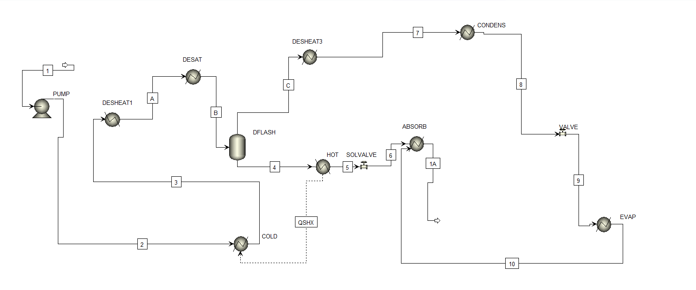
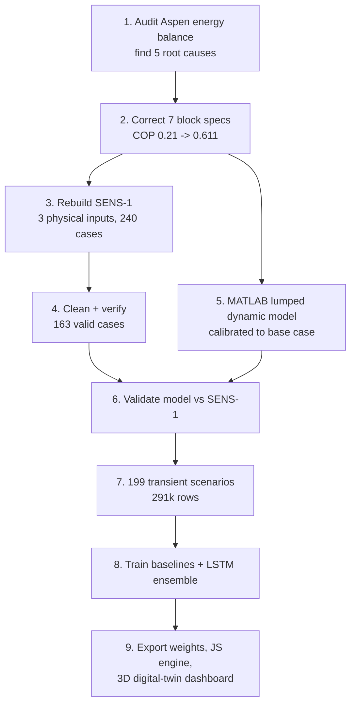

# 1. Project overview

## 1.1 Problem

Absorption chillers produce cooling from heat, such as hot water from solar collectors, waste heat or a boiler, instead of from electricity. They respond slowly: after a change in the hot-water, cooling-water or load conditions, a single-effect H₂O–LiBr machine takes **18–47 minutes** to settle. This happens because the vessel metal and the solution inventories store heat and mass.

A steady-state simulator such as Aspen Plus cannot describe that behaviour, and a full dynamic simulator is too slow for real-time use. The goal of this project is an **AI model that predicts the transient behaviour of the chiller in real time** from the external inputs alone.

## 1.2 Objectives

1. Repair and validate the existing Aspen Plus steady-state model. Its energy balance and COP were wrong.
2. Produce a clean, verified steady-state dataset (sensitivity study).
3. Build a dynamic model calibrated to that steady state, and generate a large transient dataset with it.
4. Train and compare AI models that predict the transient outputs, and select the most accurate.
5. Deploy the trained model as a live, interactive digital-twin dashboard.

## 1.3 Constraints (from the project brief, `Steady_state/Prompt.txt`)

- Do **not** rebuild the flowsheet, add or delete blocks, change stream connections, or replace equipment.
- Do **not** change the ELECNRTL property method or the component list.
- Make only the smallest justified changes, with no fudge or correction factors.
- **Never** adjust COP to match a literature value. COP must follow from correct physics.

All four constraints were respected. The Aspen fixes changed only block specifications (temperature, duty, vapour fraction or pressure), plus one Calculator, which is a flowsheet option and not a unit block.

## 1.4 The chiller

The plant is a single-effect water/lithium-bromide absorption chiller. Water is the refrigerant and the LiBr solution is the absorbent.

| Quantity (Aspen base case) | Value |
|---|---|
| Cooling capacity Q_evap | 81.1 kW (≈ 23 TR) |
| Generator heat Q_gen | 133.3 kW |
| COP | 0.608 |
| Generator / condenser / evaporator / absorber temperature | 89.89 / 46.14 / 1.74 / 33.30 °C |
| High / low pressure | ≈ 10.2 kPa / ≈ 0.70 kPa |
| Weak / strong solution | 57.40 / 59.49 wt% LiBr |
| Solution pump flow / refrigerant flow | 3600 kg/h / 126.35 kg/h |
| Circulation ratio | 28.5 |

### Aspen flowsheet

| Block | Aspen type | Role in the real chiller |
|---|---|---|
| PUMP | Pump | Solution pump: weak solution from the absorber (low P) to the generator (high P) |
| COLD | Heater | Cold side of the solution heat exchanger (SHX). It receives heat QSHX from HOT |
| DESHEAT1 | Heater | Preheater stage before the generator. Zero duty after the fixes (pass-through) |
| DESAT | Heater | **Generator**: hot water boils water vapour out of the solution. Carries the generator duty |
| DFLASH | Flash2 | Separates vapour (stream C) from the strong solution (stream 4). Adiabatic after the fixes |
| DESHEAT3 | Heater | Cools the superheated vapour to 78.4 °C (−0.76 kW, part of the generator boundary) |
| CONDENS | Heater | Condenser: vapour to liquid, heat to cooling water |
| VALVE | Valve | Refrigerant expansion valve, high P to low P |
| EVAP | Heater | Evaporator: water boils at ≈ 1.7 °C and takes heat from the chilled water (the cooling effect) |
| ABSORB | Heater | Absorber: strong solution absorbs the vapour, and heat goes to cooling water |
| HOT | Heater | Hot side of the SHX: strong solution cools from T_gen to 53.3 °C |
| SOLVALVE | Valve | Solution valve, high P to low P |

| Stream | From → To | Contents |
|---|---|---|
| 1 / 1A | ABSORB → PUMP | Weak solution. Aspen cycle break (tear): 1A leaves the absorber, 1 is the pump feed |
| 2 | PUMP → COLD | Weak solution, high P |
| 3 | COLD → DESHEAT1 | Preheated weak solution |
| A | DESHEAT1 → DESAT | Weak solution (= stream 3 after the fix) |
| B | DESAT → DFLASH | Boiling two-phase mixture |
| C | DFLASH → DESHEAT3 | Refrigerant vapour |
| 7 | DESHEAT3 → CONDENS | Vapour at 78.4 °C |
| 8 | CONDENS → VALVE | Liquid water |
| 9 | VALVE → EVAP | Flashed refrigerant, about 7 % vapour |
| 10 | EVAP → ABSORB | Saturated vapour |
| 4 | DFLASH → HOT | Strong solution |
| 5 | HOT → SOLVALVE | Cooled strong solution (53.3 °C) |
| 6 | SOLVALVE → ABSORB | Strong solution at low P, slightly flashed |
| QSHX | HOT → COLD | Heat stream (≈ 68 kW) |

## 1.5 Approach

Why a separate MATLAB dynamic model, not Aspen Plus Dynamics:
- The Aspen model has no vessel geometry or hold-ups.
- It has no water circuits; its duties are process-side only.
- It contains an intentional cycle break.
- Pressure-driven ELECNRTL flashes at 0.7–10 kPa are fragile.

Converting it would have meant rebuilding the flowsheet, which the brief forbids. The standard approach in the literature (Kohlenbach & Ziegler 2008) is a lumped-parameter dynamic model calibrated to a validated steady state. That is what was done here.

## 1.6 Deliverables

| Deliverable | Location |
|---|---|
| Corrected Aspen specifications and audit | `Steady_state/Aspen_fix_parameters.md` |
| Sensitivity setup guide | `Steady_state/SENS-1_setup_guide.md` |
| Final steady-state dataset | `Steady_state/SENS1_clean_dataset.xlsx` |
| Dynamic model and dataset generator | `Transient/` |
| Transient dataset (291,437 rows) | `Transient/output/transient_dataset.csv` |
| Trained AI model (PyTorch + portable JSON) | `ML_model/outputs/models/` |
| Metrics, predictions, figures | `ML_model/outputs/results/`, `ML_model/outputs/figures/` |
| Digital twin dashboard | `Dashboard/chiller_dashboard.html` |
| Documentation | `README.md`, `docs/` |
