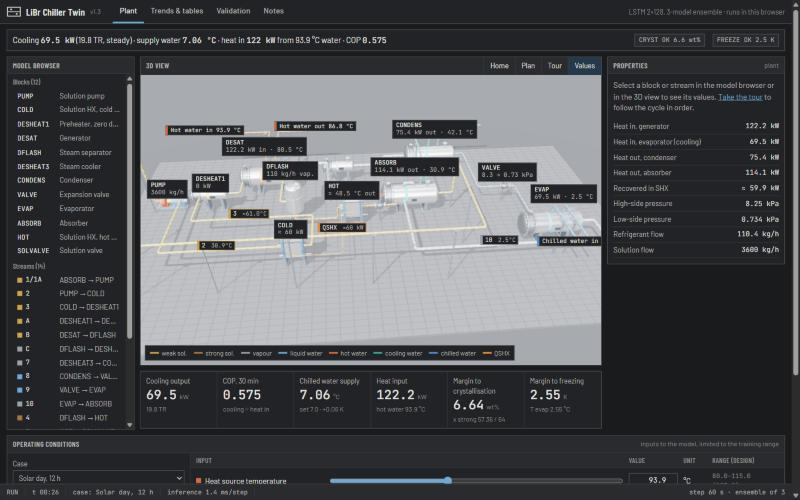
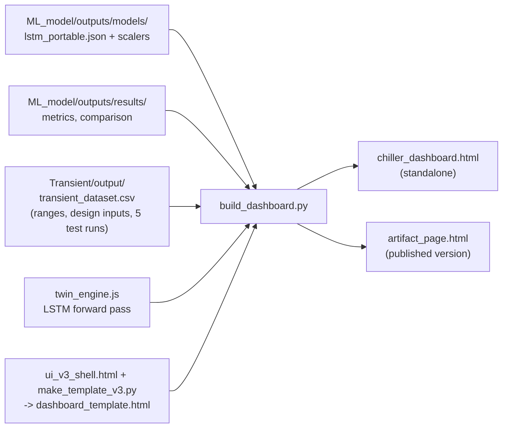
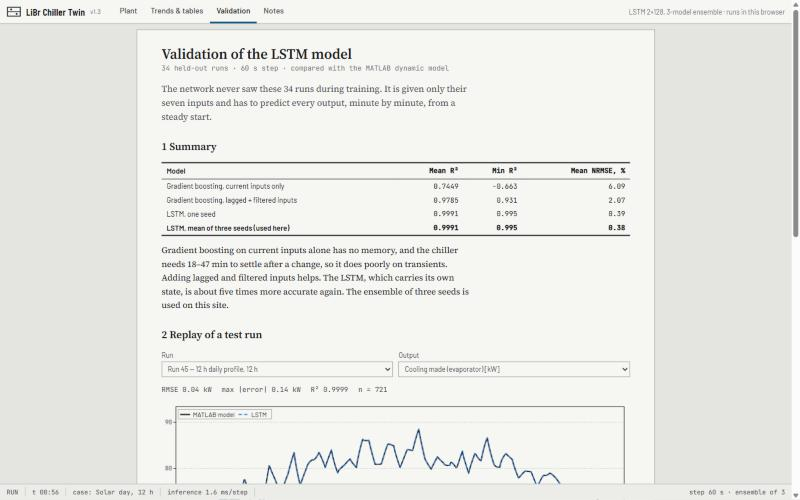
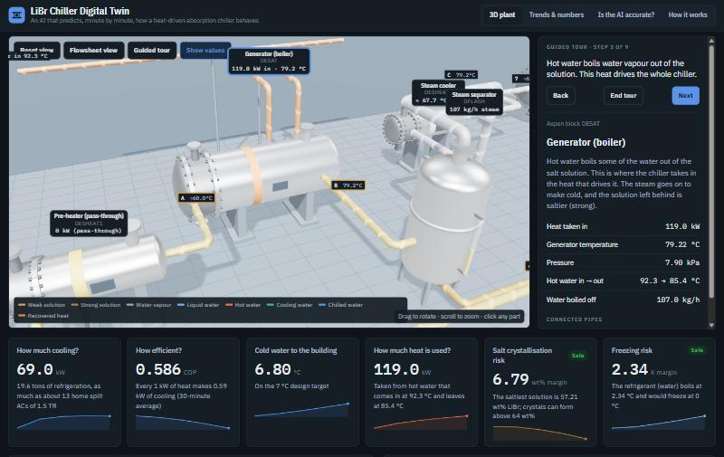

# 5. Stage 4 — Digital twin dashboard

Folder: [`Dashboard/`](../Dashboard/). Deliverable: **`Dashboard/chiller_dashboard.html`**. Double-click it to open in Chrome or Edge.



## 5.1 What it does

- Runs the trained 3-member LSTM ensemble **inside the browser**, one 60 s plant step at a time. No server and no Python are needed.
- Lets the user drive the plant with:
  - preset cases: design point, solar day, hot water 105 → 90 °C, cooling water 27 → 32 °C, chilled return 12 → 15 °C, warm start 80 → 105 °C, pump to 85 %;
  - or the 7 inputs, through sliders and numeric boxes.
- Shows the plant in **3D**, laid out like the Aspen flowsheet. Animated flow direction inside every pipe scales with the predicted flow. Every block and stream shows live values.
- Explains every block and stream in plain language, through a properties panel and a 9-step guided tour.
- Shows trends, a live **stream table for every Aspen stream**, all 16 outputs with the ensemble spread, the energy balance and the water circuits.
- Reproduces the validation: replays 5 unseen test runs with the model running live, against the MATLAB truth.

## 5.2 Architecture



| File | Role |
|---|---|
| `twin_engine.js` | Pure-JavaScript LSTM. It decodes base64 float32 weights, then per step: z-score the input → 2 LSTM layers (gates i, f, g, o) → Linear-tanh-Linear → de-scale. It returns the ensemble mean plus the min and max across members. `reset(u)` runs the 60-step warm-up |
| `build_dashboard.py` | Packs everything into the page: weights (3 × 219,792 float32 parameters as base64), scalers, training input ranges, design inputs u0, test metrics, and 5 test runs (daily 45, aprbs 54, step 5, ramp 23, startup 37) with inputs and truth. It replaces `NaN` with `null` for valid JSON |
| `ui_v3_shell.html` | Current interface: HTML, CSS and UI JavaScript |
| `make_template_v3.py` | Combines the shell with the tested core code (physics helpers, scenarios, descriptions, 3D plant) from `dashboard_template_v2_3d.html` into `dashboard_template.html` |
| `dashboard_template.html` | Template with `/*__ENGINE__*/` and `/*__DATA__*/null` placeholders |
| `dashboard_template_v1_2d.html`, `dashboard_template_v2_3d.html` | Earlier interface versions, kept for reference |
| `dashboard_data.json` | The packed data on its own, used for verification with Node.js |
| `chiller_dashboard.html` | Standalone page (adds the `<!doctype>` skeleton) |
| `artifact_page.html` | The same page without the skeleton, for publishing as a claude.ai artifact |

## 5.3 Verification of the JavaScript engine

- **Equivalence with PyTorch:** test run 45 (721 steps) was run through `twin_engine.js` in Node.js and compared with the PyTorch ensemble predictions in `test_predictions_best_model.csv`. The maximum absolute difference over all 16 outputs is **0.0014 kW** (Q_abs). All temperatures agree within 1 × 10⁻⁴ K. This is float32 rounding.
- **Long-horizon stability:** 3000 steps (50 h) at constant design inputs drift less than 0.003 kW. Four repeated 12 h solar days give identical daily cycles, so the model stays stable beyond the 12 h training horizon.
- **Speed:** about 1.5 ms per step for the 3-member ensemble in the browser, shown in the status bar.

## 5.4 Derived stream values (marked ≈ in the interface)

The LSTM predicts 16 outputs. Streams that are not predicted directly are derived from them:

| Stream / value | Relation | Accuracy check |
|---|---|---|
| 1, 1A, 2 | T_abs, x_weak, P_low/P_high, m_pump | direct |
| 3, A (SHX cold out) | T_abs + 0.606·(T_gen − T_abs). DESHEAT1 has zero duty, so A = 3 | RMSE 0.85 K vs MATLAB T_shx_weak_out over the whole dataset |
| B | T_gen, two-phase; vapour fraction = m_ref/m_pump | direct |
| C | Vapour at T_gen, P_high, m_ref | direct |
| 7 | T_gen − 11.5 K (DESHEAT3 drop in the Aspen base case) | design value |
| 8 | Liquid at T_cond, P_high | direct |
| 9 | T_evap, flash fraction c_p(T_cond − T_evap)/h_fg | 7.08 % in Aspen |
| 10 | Vapour at T_evap, P_low | direct |
| 4 | Strong solution at T_gen, x_strong, m_pump − m_ref | direct |
| 5 (SHX hot out) | T_gen − 0.645·(T_gen − T_abs) | RMSE 0.95 K vs MATLAB |
| 6 | min(T5, Dühring T(x_strong, T_evap)) | 39.5 vs 38.2 °C in Aspen |
| QSHX | m_strong · 1.93 kJ/kg K · (T_gen − T5) | ≈ 68 kW at design (Aspen 68.0) |
| Cooling water between absorber and condenser | T_cw,in + Q_abs/(m_cw·c_p) | energy balance |

## 5.5 The 3D plant

- Built with **three.js 0.147** (UMD builds from jsDelivr: core, OrbitControls, CSS2DRenderer, RoomEnvironment). All equipment is **modelled in code** with PBR materials and environment lighting:
  - shell-and-tube exchangers with bolted channel flanges, saddles, nozzles and colour bands: DESHEAT1, DESAT, DESHEAT3, CONDENS, EVAP, ABSORB;
  - a vertical separator drum with legs and a sight glass: DFLASH;
  - plate heat exchangers with frame, plate pack and tie bolts: HOT, COLD;
  - a centrifugal pump with finned motor, coupling guard and rotating coupling;
  - globe valves with handwheels: VALVE, SOLVALVE.
- **Layout:** the pixel positions of the Aspen flowsheet are mapped to the ground plane. Pipes follow the flowsheet routing with rounded bends. The return line 1A/1 runs on an overhead pipe rack. Hot, cooling and chilled water lines are on racks, with live in and out labels.
- **Flow animation:** a chevron emissive texture scrolls along every pipe. Its speed is proportional to the predicted mass flow, refrigerant flow or QSHX.
- **Interaction:**
  - click or hover any part to select it; the camera flies to it and the part is highlighted;
  - Home and Plan (top, flowsheet-like) views;
  - a Values toggle;
  - a guided tour;
  - automatic label decluttering, where lower-priority labels hide when they overlap.
- Downloaded CAD models were **not** used. Free models usually need accounts, have mixed licences, do not match the flowsheet blocks, and are heavy for a web page. Equipment built in code can be linked to live data part by part. The shapes are generic, not to scale.

## 5.6 Interface design (v1.3)

The final interface follows **plant-HMI conventions** (ANSI/ISA-101) and engineering-software patterns:

| Element | Description |
|---|---|
| Menu bar | App name, version, views: Plant, Trends & tables, Validation, Notes |
| Status line | One-sentence plant summary with alarm boxes: CRYST OK / LOW MARGIN / ALARM and FREEZE OK / LOW MARGIN / ALARM |
| Model browser | Aspen-style tree of the 12 blocks, the streams and the utilities, with live utility temperatures |
| 3D view | Framed viewport with a toolbar (Home, Plan, Tour, Values) and a legend |
| Readout strip | 6 instrument cells: cooling output (kW, TR), COP over 30 min, chilled-water supply vs the 7 °C setpoint, heat input, crystallisation margin, freezing margin. They are grey when normal; an amber or red bar and a flag appear only when abnormal |
| Properties | Block or stream description, Aspen block type, live values table, connected streams, tour controls |
| Operating conditions | Case selector, run/pause/restart, speed, and a table of the 7 inputs with slider, numeric box, unit and range (design value) |
| Status bar | RUN/HOLD, plant time, case, inference time per step |
| Trends & tables | 4 plot-style figures (framed axes, outward ticks, legend box, numbered captions), stream table, outputs table, energy balance, water circuits |
| Validation | Report page: summary table, replay with Fig. 5 and Fig. 6, per-output accuracy table |
| Notes | Report page: the cycle, build pipeline, design point, model card, valid input range, derived values, limitations, terms, references |

Design rules:
- Grey ground, square panels and 1 px rules.
- Colour only for process media and abnormal states.
- Fonts: Barlow and Barlow Condensed for the interface, JetBrains Mono for values, Source Serif 4 for report text.
- Booktabs-style tables.
- Light and dark themes.
- Responsive down to 375 px.



### Version history of the interface

| Version | Description |
|---|---|
| v1 (`dashboard_template_v1_2d.html`) | 2D SVG schematic, KPI tiles, trends, validation and details tabs |
| v2 (`dashboard_template_v2_3d.html`) | 3D plant laid out like the Aspen flowsheet, plain-language panels, guided tour, stream table |
| **v1.3 / v3 (current)** | Complete restyle as engineering software (ISA-101 HMI plus report pages). All v2 functions kept |



## 5.7 Build and publish

```bash
cd Dashboard
python make_template_v3.py     # only after editing ui_v3_shell.html
python build_dashboard.py      # -> chiller_dashboard.html, artifact_page.html, dashboard_data.json
```

### Hosting on Vercel

The dashboard is live at **https://libr-chiller-twin.vercel.app**. It is the Vercel project `libr-chiller-twin` in the team `malav-parekhs-projects`.

| File | Role |
|---|---|
| `Dashboard/vercel.json` | Serves `chiller_dashboard.html` at `/`, with clean URLs and no caching |
| `Dashboard/.vercelignore` | Uploads only `chiller_dashboard.html` and `vercel.json`. Build scripts, templates and data stay out of the deployment |

To redeploy after rebuilding the page:

```bash
cd Dashboard
npx vercel@latest deploy --prod --scope malav-parekhs-projects --name libr-chiller-twin
```

The page is about 4 MB, because it contains the weights and test runs. The AI and the numbers work offline. The 3D view and the web fonts need internet the first time.
